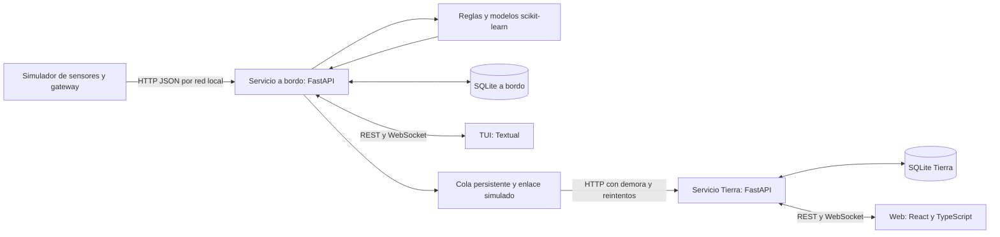

ASTRO-VITALS — arquitectura técnica propuesta
============================================

Diseño del MVP, revisado el 4 de noviembre de 2026. El [alcance funcional](MVP_ASTRO_VITALS.md) define la experiencia prevista. El [contrato de datos y salidas](CONTRATO_DE_DATOS.md) es la referencia compartida para las variables, los objetivos y la disponibilidad de cada componente.

**Actualización de implementación, 28 de octubre:** ya existe un [prototipo reducido 0.1](prototype/README.md) con pasarela HTTP, API y TUI. Usa Python 3.14 disponible en este equipo, reglas de demostración y memoria; el resto de este documento conserva el diseño previsto para el MVP completo. La captura aportada por el equipo anuncia los recursos para el **13 de noviembre de 2026**. La demo incorpora un registro BIDMC de PhysioNet y no depende de esa publicación; ver [fuentes alternativas](DATOS_ALTERNATIVOS.md).

**Decisión general.** Un monorepositorio, dos nodos lógicos —a bordo y Tierra— y cuatro procesos Python durante la demostración: simulador, servicio a bordo, TUI y servicio Tierra. La web se compila y la sirve el nodo Tierra. El entrenamiento es una tarea separada, ejecutada antes de iniciar la demostración; la inferencia ocurre a bordo.

El primer pronóstico se evaluará con FC y FR de BIDMC. El clasificador de cuatro patrones requiere sesiones sintéticas etiquetadas con actividad, referencia personal y CO₂ sincronizados. La simulación solar usa reglas y dosimetría. Queda por revisar qué recursos del desafío y qué referencias NASA se pueden incorporar.



**Tecnologías elegidas para la primera implementación.**

| Parte | Elección | Responsabilidad |
| --- | --- | --- |
| Runtime Python | 3.14 en el prototipo 0.1. 3.12.x propuesto para el MVP completo | Verificar compatibilidad con las dependencias de entrenamiento antes de fijar el entorno común |
| Dependencias Python | uv, pyproject.toml y uv.lock | Fijar versiones reproducibles una vez comprobada la instalación |
| API | FastAPI, Pydantic 2, Uvicorn | Contratos, validación, REST, WebSocket y documentación OpenAPI |
| Cliente HTTP Python | HTTPX | Enviar telemetría, consultar APIs y transmitir a Tierra |
| Cliente WebSocket Python | websockets | Actualizaciones de la TUI |
| Datos y entrenamiento | NumPy, pandas y scikit-learn | Generación, transformación, variables temporales, entrenamiento y evaluación |
| Clasificación | RandomForestClassifier | Reconocer cuatro patrones definidos en la simulación |
| Pronóstico | RandomForestRegressor | Estimar frecuencia cardíaca a 60 segundos |
| Artefactos del modelo | joblib y manifiesto JSON | Cargar modelos propios y verificar su contrato de variables |
| Interfaz astronauta | Textual y sus componentes | Estado, hipótesis, evidencia, procedimientos e historial |
| Almacenamiento | SQLite con sqlite3 de Python | Mediciones, análisis, episodios, eventos de interfaz y cola |
| Web Tierra | React + TypeScript + Vite | Estado recibido, historial y gráficas |
| Estilos y gráficas web | CSS propio y Recharts | Interfaz pequeña, responsive y visualización temporal |
| Runtime de desarrollo web | Node.js 24 LTS y npm | Compilar y desarrollar; no es necesario mantener Node en ejecución para servir la demo compilada |
| Pruebas | pytest, HTTPX y pruebas de interacción de Textual | Contratos, modelo, continuidad y flujo de usuario |
| Calidad y scripts | Ruff, TypeScript en modo estricto, PowerShell | Revisiones estáticas y arranque reproducible en Windows |

Las versiones patch se fijarán tras la primera instalación y prueba de compatibilidad, no se inventan en este documento. uv permite sincronizar un entorno con su archivo de bloqueo; Vite produce la compilación de la web. [Documentación de uv](https://docs.astral.sh/uv/concepts/projects/sync/), [guía de Vite](https://vite.dev/guide/).

La primera versión no necesita un broker de mensajes ni un servicio independiente para el modelo. La cola es una tabla del nodo a bordo y el análisis es un módulo Python. Este alcance evita que la integración dependa de numerosos servicios.

**Conexión de sensores y despliegue.** El diseño físico previsto es: sensores del wearable → pasarela compatible → red local de la nave → API a bordo. BLE, conexión cableada o un adaptador de cabina dependerán del dispositivo real. HTTP empieza en la pasarela, no obliga a que cada sensor implemente una API.

Para el hackatón, el simulador ocupa el lugar de la pasarela y emite el mismo contrato que usaría un dispositivo. Puede correr en otra computadora. El portátil del astronauta ejecuta la TUI y se conecta al servicio a bordo; no requiere que los sensores se conecten físicamente a él.

Se puede demostrar todo en una computadora mediante procesos y puertos separados. Si hay dos equipos, se reparte el nodo Tierra o el simulador por la red local. Cada nodo conserva su propia base de datos; la vista Tierra nunca lee directamente la base de a bordo. Direcciones y puertos se configuran mediante ONBOARD_URL, GROUND_URL y rutas de datos.

Ejemplo de puertos propuestos: nodo a bordo 8000 y nodo Tierra 8001. En desarrollo, Vite usa su servidor; en la demostración, el nodo Tierra sirve los archivos estáticos compilados. Todos los recursos necesarios para funcionar sin internet deben estar descargados localmente.

**Muestra y frecuencia de trabajo.** Se trabaja con parámetros resumidos aproximadamente a 1 Hz, un astronauta ficticio y un módulo de cabina. Esta frecuencia no representa la adquisición de ECG u otras señales crudas. El simulador permite regular actividad, ruido, evolución fisiológica y pérdida de señales.

El [diccionario de entradas](CONTRATO_DE_DATOS.md#entradas) distingue las señales que requiere cada modelo de los campos destinados a visualización o revisión. El nodo deriva el tiempo en la actividad, las diferencias respecto a la calibración y la dosis acumulada a partir de observaciones con tiempo conocido.

Si una fuente entrega CO₂ en ppm, la conversión a presión parcial necesita la presión total correspondiente: ppCO₂ = ppm × presión_total_mmHg / 1 000 000. No asumir presión terrestre de manera silenciosa. Una lectura faltante se representa como null con calidad correspondiente, nunca como cero.

No se calculará HRV a partir de una columna de pulso a 1 Hz. Incorporarla requeriría intervalos entre latidos y procesamiento adicional, por lo que queda fuera de las entradas del modelo v1.

**Contrato de entrada previsto.** En 0.1, POST /api/v1/telemetry acepta una muestra plana con `hr`, `rr`, `co2`, `dose_rate`, `activity` y una fuente por muestra. En el MVP, la pasarela enviará un paquete de una o varias mediciones con procedencia por señal. La migración deberá distinguir el formato por versión y conservar la reproducción del registro 01. El nuevo envoltorio contiene schema_version, packet_id, run_id, gateway_id y sent_at. Cada medición contiene:

| Campo | Significado |
| --- | --- |
| sample_id y device_id | Identidad de la medición y su dispositivo |
| crew_id y location_id | A quién o a qué ubicación corresponde; una lectura de cabina puede no tener crew_id |
| measured_at | Momento de la medición en la línea temporal de la sesión |
| signal, value, unit | Variable, valor numérico o null, unidad normalizada |
| quality | valid, missing o invalid; stale se calcula también a partir de la antigüedad |
| source_kind | simulated, replayed o measured |
| source_ref | Referencia al archivo, dispositivo o transformación que produjo el dato |

El servidor añade received_at. En una reproducción se conserva original_measured_at si existe una fecha original, u original_time_s si solo existe un tiempo relativo, como en BIDMC. Los eventos DONKI usan su propio contrato de evento externo y mantienen su fecha histórica.

La actividad tiene un contrato de contexto separado. POST /api/v1/crew/{id}/activity recibe event_id, run_id, activity (rest, exercise, recovery o unknown), activity_started_at si se conoce, reported_at y source_kind (declared, replayed o simulated). Se usa la información conocida en el instante del análisis. Sin fase o comienzo conocidos, el clasificador indica no_evaluable. El pronóstico básico puede calcularse con FC y FR. event_id permite reintentos sin duplicados. El autorreporte se conserva como observación del episodio para revisión humana.

Los identificadores de escenario, etiquetas de entrenamiento, semillas y parámetros internos del generador quedan en los archivos de evaluación. No son entradas del modelo ni órdenes de generar una alerta. run_id y las identidades se usan para trazabilidad y partición, no como variables predictoras.

La API valida estructura y unidades. Confirma la aceptación después de guardar. Reenviar el mismo sample_id y contenido no crea otra medición; reutilizarlo con contenido diferente se trata como conflicto. El simulador conserva un lote no confirmado para reintentarlo.

**Flujo interno del nodo a bordo.**

1. Recibir, validar y normalizar la telemetría.
2. Persistir las mediciones y confirmar la recepción a la pasarela.
3. Actualizar calidad y reunir la ventana reciente del astronauta y del ambiente correspondiente a su ubicación.
4. Ejecutar reglas y, cuando sea evaluable, extraer variables y ejecutar los modelos.
5. Guardar el análisis, actualizar episodio/estado, insertar ui_events y outbox, y avanzar el cursor de procesamiento en una misma transacción. Una actualización incremental de dosis incluye en esa misma transacción su acumulado y el cursor de integración, para evitar doble acumulación tras un reinicio.
6. Exponer el estado a la TUI y permitir al emisor intentar la entrega a Tierra.

Se ejecuta un único worker Uvicorn por nodo. La inferencia y operaciones potencialmente bloqueantes se ejecutan fuera del bucle de atención de conexiones, mediante un ejecutor limitado; no se acumula una tarea de inferencia por cada paquete. La interfaz puede mostrar mediciones nuevas mientras espera el próximo análisis, indicando hasta qué instante fue calculado.

El almacenamiento utiliza una capa de repositorio con transacciones cortas y conexiones controladas, evitando compartir una conexión sqlite3 simultáneamente entre hilos. Cada nodo es el único propietario de su archivo. El cursor de procesamiento se persiste; al reiniciar, el motor reconstruye la ventana reciente desde SQLite y evita duplicar análisis ya guardados. La clave del análisis incluye sesión, astronauta, final de ventana y versión del modelo.

**Arquitectura del motor de interpretación.** Tiene cuatro capas con responsabilidades distintas:

| Capa | Implementación | Salida |
| --- | --- | --- |
| Calidad y disponibilidad | Reglas Python | Evaluable, calibrando, señal ausente/desactualizada, modelo no disponible |
| Reconocimiento de patrones | RandomForestClassifier | Clase del patrón simulado e información interna de decisión |
| Pronóstico de pulso | RandomForestRegressor | FC estimada en bpm para t + 60 s |
| Presentación explicada | Plantillas y evidencia estructurada | Hipótesis orientativa, observaciones, alternativas y revisión ilustrativa |

Las reglas ambientales continúan funcionando aunque el modelo no esté disponible. Los límites tomados de referencias NASA deben incluir revisión, sección, unidad, duración de exposición y contexto. Los parámetros inventados para escenarios llevan la etiqueta de configuración de demostración.

**Clasificador v1.** Se elige Random Forest porque permite trabajar con una tabla de variables temporales y un entrenamiento local sencillo. La documentación describe su combinación de árboles; su rendimiento en este proyecto se medirá, no se presume superior al de otras opciones. [RandomForestClassifier](https://scikit-learn.org/stable/modules/generated/sklearn.ensemble.RandomForestClassifier.html).

Cada 5 segundos el clasificador resume los últimos 120 s de FC, FR y CO₂ local y añade fase, duración y diferencias personales. Su objetivo es el patrón etiquetado en esa ventana. Cada modelo tiene su propio manifiesto de variables. [Entradas y objetivos por modelo](CONTRATO_DE_DATOS.md#qué-aprende-cada-modelo)

La referencia personal se obtiene de 120 segundos anteriores de reposo válido o de una calibración guardada de la misma persona ficticia. Mientras no exista, se muestra calibración pendiente. Para la demo se puede cargar historia previa identificada como tal; nunca datos futuros. La referencia permanece fija durante el episodio evaluado.

Cuatro clases iniciales del generador:

- baseline_expected: patrón de reposo esperado en la simulación.
- activity_expected: respuesta y recuperación previstas para una actividad.
- persistent_recovery_deviation: recuperación que se aparta del patrón personal simulado.
- combined_cabin_physiology_pattern: patrón conjunto de cabina y fisiología definido por el generador.

La última clase puede mostrarse como «hipótesis de alteración respiratoria relacionada con el entorno, dentro del escenario simulado». No equivale a un diagnóstico confirmado de hipercapnia. Las clases no incluyen radiación ni fallo de sensor: esos casos pertenecen al motor ambiental y a la capa de calidad.

Configuración inicial de ingeniería: n_estimators=100, max_depth=8, min_samples_leaf=5, class_weight=balanced_subsample, random_state=42 y n_jobs=1. Se cambia solo si la validación lo justifica. Las ventanas con transiciones pueden anotarse como ambiguas y evaluarse separadamente; no asignar la misma etiqueta a todo un archivo que contiene fases diferentes.

Los criterios iniciales de calidad se aplican a cada canal requerido. El análisis indica no_evaluable y el motivo si falta historial, calibración o una entrada obligatoria. La falta de calibración se presenta como «calibrando». Los parámetros de cobertura y antigüedad se ajustan durante la validación. [Reglas de disponibilidad](CONTRATO_DE_DATOS.md#qué-calcula-el-sistema-y-qué-muestra-la-interfaz)

Un umbral de abstención basado en la salida del clasificador se ajusta con validación y se registra. Una puntuación alta no prueba que un caso esté dentro del dominio conocido, ni es una probabilidad médica. Los casos fuera de la cobertura ensayada requieren pruebas adicionales; el prototipo no promete reconocer todos los escenarios desconocidos.

**Pronóstico v1.** RandomForestRegressor usa únicamente el historial de FC y FR hasta t para estimar la FC en t + 60 s. La etiqueta se obtiene del mismo registro durante el entrenamiento. Con ambas señales válidas, el pronóstico puede calcularse incluso cuando la actividad es desconocida o faltan calibración y CO₂. [RandomForestRegressor](https://scikit-learn.org/stable/modules/generated/sklearn.ensemble.RandomForestRegressor.html).

Se compara con conservar la última FC y con extrapolar una tendencia breve. Se mide el error absoluto medio en bpm en registros reservados. Con una fuente que identifique actividad se podrá desglosar también el error en sus transiciones. Si el modelo no mejora la mejor referencia en validación, se utiliza esa referencia y la interfaz muestra su nombre.

La predicción fisiológica a seis horas no es un requisito del modelo v1. Si se conserva una visualización a seis horas, corresponde a una proyección explícita del escenario o de exposición bajo supuestos, y se distingue del pronóstico de pulso entrenado. No se obtiene extendiendo repetidamente el modelo de 60 segundos.

**Entrenamiento y evaluación.** El conjunto de fusión v2 contiene 120 sesiones de 15 minutos, cuatro por cada uno de 30 perfiles ficticios. Las señales generadas de FC, FR y CO₂ se sincronizan dentro de cada sesión. Se varían la intensidad, los tiempos de recuperación, el ruido y los huecos de sensor. La posición del cambio de cabina varía para que el tiempo en la fase de reposo por sí solo no identifique esa clase.

Se asignaron 20 perfiles a entrenamiento, cinco a validación y cinco a prueba con semillas separadas. Las cuatro clases tienen ejemplos en cada partición. Las transiciones, los patrones simultáneos y las pérdidas de señal conservan anotaciones de auditoría para evaluar el comportamiento en estos escenarios.

Para el pronóstico se prepararon las ventanas BIDMC con una partición independiente por participante. Actividad, estrés y sueño tienen tablas terrestres propias. RR-1 proporciona CO₂ y radiación históricos de la instalación en las unidades originales. [Preparación del pronóstico](data/bidmc/README.md) · [Datos del clasificador](data/fusion_simulada/README.md) · [Inventario](DATOS_ALTERNATIVOS.md)

El mismo módulo features.py se usa en entrenamiento e inferencia. Cada artefacto guarda clasificación o regresión más un manifest.json con versión, unidades, nombres y orden de variables, ventanas, horizonte, semillas, particiones, versiones de dependencias y métricas. Solo se cargan artefactos propios mediante joblib, dado que ese formato puede ejecutar código al cargar; se conserva la misma versión del entorno de entrenamiento. [Persistencia de modelos en scikit-learn](https://scikit-learn.org/stable/model_persistence.html).

**Explicación y contrato del análisis.** El análisis identifica assessment_id, crew_id, run_id, window_start y window_end. Cada componente comunica disponibilidad, motivo e input_quality. Un resultado entrenado identifica model_version y features_version. El valor de pattern conserva la etiqueta o null, con la referencia personal y hypothesis_text cuando apliquen. forecast indica valor en bpm o null, instante objetivo y método (modelo, persistencia o tendencia). La evidencia calculada (observations), las alternativas y los pasos de revisión (next_review_steps) acompañan al episodio. El autorreporte se guarda aparte con autor y hora. La TUI y Tierra presentan los resultados disponibles aunque otro componente esté calibrando o tenga datos insuficientes.

Las observaciones son hechos calculados: diferencias respecto a la referencia, duración de cambios y calidad disponible. No se presentan como porcentajes de causalidad ni como atribuciones exactas del bosque. El texto se construye con plantillas versionadas para mantener la salida consistente y disponible sin conexión. No se necesita un LLM para este MVP.

La interfaz muestra hipótesis y fuente del dato junto al estado de simulación. Un procedimiento ilustrativo permite verificar señales y registrar observaciones; no prescribe tratamientos. El reconocimiento humano, la condición activa y la entrega a Tierra son estados independientes. Reconocer una alerta no la resuelve.

**Tormenta solar y exposición.** Ya está guardado el evento SEP observado por STEREO A el 11 de mayo de 2024 a las 04:07 UTC. El MVP puede cargar ese JSON sin conexión. El dosímetro simulado genera sus propias lecturas. La serie ambiental RR-1 pertenece a otra misión y período y se puede mostrar como referencia histórica independiente. [Evento DONKI](data/donki/README.md) · [Entorno RR-1](data/iss_rr1/README.md)

La exposición se integra a partir de la tasa de dosis equivalente, usando intervalos válidos y unidades consistentes: dosis_μSv += tasa_media_μSv_h × segundos / 3600. Si faltan lecturas, se registra cobertura incompleta; no asumir exposición cero. El acumulado de una sesión no disminuye. El control «simular refugio» modifica la tasa según un factor explícito del escenario, sin afirmar que se calculó el blindaje real.

Una proyección de exposición puede usar D_futura = D_actual + tasa_supuesta × horas. La hipótesis de tasa constante y la alternativa de refugio aparecen como supuestos; no como predicción médica. El módulo solar reutiliza episodios, explicaciones y cola, sin un tercer modelo entrenado.

**Almacenamiento.**

| Tabla o grupo | Contenido |
| --- | --- |
| measurements | Mediciones normalizadas y procedencia, con sample_id único |
| activity_events | Contexto de actividad con event_id, fase y comienzo conocidos |
| calibrations | Persona, sesión y tramo de reposo de origen, valores de FC/FR y versión de la referencia aplicada |
| external_events | Contexto histórico DONKI y referencias |
| assessments | Resultado versionado del motor y ventana de entrada |
| episodes | Inicio, evolución, condición activa y cierre de episodios |
| observations y acknowledgements | Acciones humanas asociadas a episodios |
| ui_events | Diario ordenado por secuencia para reconstruir cambios de estado |
| processing_state | Cursores y datos mínimos para recuperar el procesamiento |
| outbox | Mensajes pendientes, intentos, próxima entrega y confirmación |

Tierra conserva received_messages con message_id único y su propia representación de mediciones, análisis y episodios recibidos. La recepción, la actualización de ese estado y sus ui_events se confirman en una sola transacción antes de responder al emisor. El MVP no elimina sesiones automáticamente. Los esquemas se inicializan con una versión de base de datos registrada.

**API mínima y responsabilidades.**

| Nodo | Ruta propuesta | Responsabilidad |
| --- | --- | --- |
| A bordo | POST /api/v1/telemetry | Ingestión idempotente |
| A bordo | POST /api/v1/crew/{id}/activity | Registrar la fase de actividad conocida y su inicio |
| A bordo y Tierra | GET /api/v1/crew/{id}/state | Estado disponible y revisión del diario |
| A bordo y Tierra | GET /api/v1/events?after={seq} | Recuperar cambios persistidos posteriores a una secuencia |
| A bordo y Tierra | WS /api/v1/crew/{id}/stream?after={seq} | Entregar cambios a partir de un cursor |
| A bordo y Tierra | GET /api/v1/episodes/{id} | Detalle y evidencia disponible |
| A bordo | POST /api/v1/episodes/{id}/observations | Registrar contexto aportado por el astronauta |
| A bordo | POST /api/v1/episodes/{id}/acknowledgements | Registrar reconocimiento, sin cerrar la condición |
| Tierra | POST /api/v1/messages | Aceptar un mensaje del enlace después de persistirlo |
| A bordo y Tierra | GET /health | Estado del servicio, modelo y almacenamiento |

La TUI usa solo estos contratos; no accede a SQLite ni importa código de inferencia. El nodo Tierra expone lo recibido y no recalcula como si tuviera telemetría instantánea. Los contratos Python se definen con Pydantic y su esquema OpenAPI sirve de referencia para los tipos TypeScript. [FastAPI](https://fastapi.tiangolo.com/), [Pydantic](https://docs.pydantic.dev/latest/).

Un snapshot de estado incluye su secuencia en una lectura consistente. Después, la interfaz abre el WebSocket desde esa secuencia y recibe los eventos persistidos faltantes antes de continuar. Para el volumen del MVP, el servidor puede seguir el diario de SQLite por cursor, evitando la carrera entre snapshot y suscripción. Si la retención/cursor no permite recuperar, solicita un nuevo snapshot. Un corte marca la vista como desactualizada hasta recuperar datos.

WebSocket mejora la actualización visual; el diario persistente proporciona recuperación. FastAPI documenta soporte para conexiones WebSocket. [Documentación oficial](https://fastapi.tiangolo.com/advanced/websockets/).

**Enlace nave–Tierra.** Se envían episodios completos y lotes resumidos de telemetría cada cinco segundos. Los mensajes tienen message_id, run_id, crew_id, source_sequence, observed_at, created_at, schema_version y payload. Tierra añade received_at. Cada versión de un episodio se identifica para que un mensaje retrasado no reemplace un estado más reciente.

La modificación del episodio y la inserción en outbox se realizan en la misma transacción. Un emisor en segundo plano espera delivery_due_at y realiza el POST. Tierra confirma después de guardar. Solo entonces se marca entregado; ante fallo se reintenta con espera creciente limitada. Un mensaje repetido se reconoce sin duplicar su contenido. El registro pendiente sobrevive al reinicio.

La demostración inicial funciona a velocidad 1x, con un retraso configurable, por ejemplo 15 segundos, identificado como retardo simulado. No se presenta ese valor como retardo físico de Marte. Un modo acelerado es una extensión que requeriría un reloj de simulación común, etiquetas visibles y métricas consistentes; no se mezcla silenciosamente tiempo virtual con hora real.

**Interfaz del astronauta.** Textual proporciona pantallas, eventos y componentes para una TUI con navegación por teclado. [Textual](https://textual.textualize.io/). Se limitan las pantallas a Estado, Evaluación/Evidencia e Historial. Un encabezado persistente indica enlace, calidad y antigüedad; el pie muestra acciones visibles. Se emplean tendencias pequeñas para las señales, no gráficas diagnósticas de ECG.

La TUI conserva el estado de la alerta mientras se consulta otra pantalla. Las etiquetas distinguen datos simulados, mediciones y proyecciones. No depende solo del color. Las peticiones y el stream se ejecutan en tareas de fondo; perder conexión no deja la pantalla mostrando valores como si siguieran actualizados.

**Interfaz Tierra.** React y TypeScript mantienen el último estado recibido, historial y conexiones mediante hooks y un reducer pequeño. HTTP fetch y WebSocket nativos son suficientes. Recharts dibuja las series con ejes, unidades, huecos y segmentos diferenciados para pronósticos. [Recharts](https://recharts.org/).

Una vista general y el detalle de un astronauta son suficientes. Se muestran hora de medición, recepción y antigüedad. El servicio Tierra sirve el build de Vite en la misma dirección de la API durante la demo. Se incluyen fuentes y recursos locales para evitar dependencias de CDN.

**Estructura propuesta del repositorio.**

```text
backend/
  pyproject.toml
  uv.lock
  src/astro_vitals/
    contracts/       # Pydantic y eventos comunes
    onboard/         # API, ciclo de procesamiento y estado
    ground/          # receptor y API de Tierra
    storage/         # repositorios SQLite y esquema
    analysis/        # calidad, features, reglas, modelos y explicación
    transport/       # outbox, reintentos y enlace simulado
    simulator/       # generación, reproducción y cliente de pasarela
    tui/             # aplicación Textual
  tests/
frontend/ground/
  package.json
  package-lock.json
  src/
ml/                 # scripts de generación, entrenamiento y evaluación
models/             # artefactos propios y manifiestos
scenarios/          # configuración y referencias de escenarios
data/               # datos de desarrollo; bases locales fuera de Git
docs/               # contratos, fuentes, resultados y demo
scripts/            # arranque y preparación mediante PowerShell
```

No se suben bases locales ni información personal. Los archivos grandes y sus licencias se gestionan según la fuente; se conserva un procedimiento reproducible para obtenerlos. Durante la demo se usan perfiles ficticios.

**Pruebas de aceptación.**

1. Una muestra enviada por el simulador aparece en el estado a bordo y luego en Tierra con la demora configurada y su procedencia.
2. Una petición duplicada no duplica mediciones ni episodios; un mismo ID con otro contenido se rechaza como conflicto.
3. Cerrar la TUI no detiene ingestión, inferencia ni cola. Interrumpir Tierra no detiene el nodo a bordo.
4. Reiniciar el nodo a bordo recupera mensajes pendientes y la ventana de análisis; reconectar entrega sin duplicados.
5. Un hueco de sensor produce estado de calidad y nunca se convierte en cero. La interfaz detecta análisis o datos desactualizados.
6. La clasificación se evalúa por perfiles/sesiones reservados: matriz de confusión, macro-F1, falsas alertas por hora de simulación, demora y tasa de abstención.
7. El pronóstico se compara por MAE en bpm contra las referencias. Se registran tiempo de entrenamiento, tamaño y latencias p50/p95 en la máquina de demo.
8. La dosimetría respeta unidades, cobertura y acumulación; cambiar de refugio no reduce dosis ya acumulada.
9. Un compañero puede interpretar alerta, consultar evidencia y registrar una observación sin instrucciones del desarrollador.
10. La reproducción BIDMC con historia válida de FC y FR permite evaluar el pronóstico básico. En esa misma ventana, el patrón indica contexto insuficiente y las lecturas ambientales están ausentes. El método de pronóstico permanece visible en ambas vistas.

Se automatizan con pytest los contratos, transformaciones, división de datos, acumulación y recuperación del enlace. Las pruebas de interacción cubren las tareas principales de la TUI. La web y el recorrido completo se revisan también en la máquina de presentación. No se promete una precisión clínica a partir de estas pruebas.

**Orden de construcción.** Primero contratos y un recorrido completo sin modelo: simulador → API → SQLite → TUI → cola → Tierra → web. Después calidad, episodios e historial. En paralelo, datos/modelo trabajan con el mismo contrato de variables. Luego se integran clasificación, pronóstico y explicaciones; se añade el episodio solar mediante el motor existente. Finalmente se ensayan cortes, reconexión, fallos y presentación.

Las funciones del equipo se reparten en datos/modelo, nodo e integración, TUI, y web/demo; pueden combinarse según cuántas personas sean. El primer punto de integración es el contrato de telemetría y análisis, no una pantalla terminada.

**Decisiones pendientes.** El [contrato de datos](CONTRATO_DE_DATOS.md#decisiones-pendientes) ordena las decisiones sobre fuentes, etiquetas, calibración, evaluación y mensajes antes de cada etapa. Para la integración también falta asignar responsables y horas, fijar el entorno Python después de probar las dependencias y acordar la transición desde la muestra plana de 0.1 al paquete versionado. La integración física queda como adaptador futuro.
