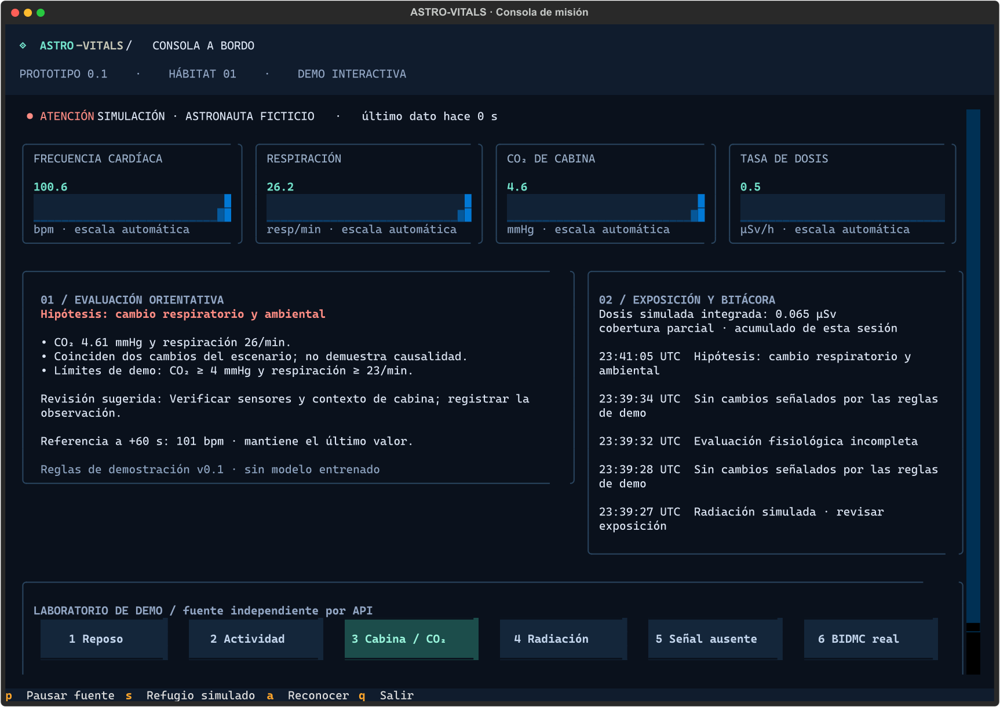

# ASTRO-VITALS

Proyecto para NASA Space Apps Cajamarca. ASTRO-VITALS busca ayudar a un astronauta a interpretar cambios en su pulso y respiración teniendo en cuenta qué estaba haciendo y cómo estaba la cabina. Por ejemplo, tras el ejercicio podrá ver si su recuperación sigue el patrón esperado, qué mediciones respaldan esa interpretación y qué conviene revisar. La base de operaciones podrá seguir el episodio aunque la comunicación con la nave llegue con retraso.

## Estado del proyecto

**Disponible hoy.** El prototipo 0.1 tiene una consola de astronauta, una pasarela de datos y una API a bordo. Permite reproducir un registro fisiológico real, simular ejercicio, cambios de CO₂, radiación y pérdida de señal, y reconocer avisos. La evaluación usa reglas explícitas y el historial se guarda en memoria. También están preparados los datos de entrenamiento, validación y prueba para los dos modelos del MVP.

**Próxima entrega.** Entrenar y evaluar los modelos, integrarlos en el servicio a bordo, guardar episodios en disco y conectar la vista de Tierra. Las hipótesis del clasificador describirán patrones de simulación. La aplicación mostrará la procedencia y antigüedad de las mediciones junto a cada resultado.



## Vistas y funcionamiento

| Vista | Qué podrá hacer su usuario |
| --- | --- |
| **Astronauta · a bordo** | Consultar señales, actividad y calidad de los sensores. Abrir un aviso para ver qué cambió, desde cuándo y respecto a qué referencia. Registrar esfuerzo o malestar y reconocer el aviso. La consola básica ya funciona. |
| **Base de operaciones · Tierra** | Ver el último estado recibido de cada astronauta, comparar tendencias y revisar episodios y observaciones. Mostrará por separado la hora de medición y la de recepción para reconocer información atrasada. Esta vista está planificada. |

En el MVP, la pasarela enviará la telemetría al servicio de la nave. Ese servicio hará el análisis local, actualizará la consola y guardará los mensajes pendientes. Si se corta el enlace, la nave podrá seguir registrando episodios. Al volver la conexión, Tierra recibirá los mensajes pendientes y reconocerá los duplicados.

## Stack tecnológico

| Componente | Tecnología | Estado |
| --- | --- | --- |
| Pasarela, API y consola | Python, FastAPI, Pydantic, HTTPX y Textual | En uso. La consola consulta la API local por HTTP. |
| Preparación de datos y modelos | Python y NumPy para los datos. pandas y scikit-learn para el entrenamiento previsto | Datos preparados. Los modelos del MVP están por entrenar e integrar. |
| Historial y sincronización | SQLite en cada nodo, cola persistente, HTTP y WebSocket | Planificado para conservar y transmitir episodios. |
| Vista web de Tierra | React, TypeScript, Vite y Recharts | Planificado para el panel y sus gráficas. |
| Verificación | pytest en el prototipo y pruebas de integridad en Python | En uso para contratos, señales, etiquetas y particiones de datos. |

## Modelos que vamos a construir

| Modelo | Entradas y salida | Datos para construirlo |
| --- | --- | --- |
| **Pronóstico de frecuencia cardíaca** · Random Forest de regresión | Usa el historial de frecuencia cardíaca (FC) y respiratoria (FR) para estimar la FC **60 segundos después**, en latidos/minuto. | [BIDMC](data/bidmc/README.md). 3.170 ventanas reales de registros hospitalarios terrestres, separadas por participante. La respuesta de entrenamiento es la FC observada un minuto después en el mismo registro. |
| **Clasificación de patrones** · Random Forest de clasificación | Usa FC, FR, CO₂ local, actividad, duración de la fase y diferencias respecto a la referencia personal. Distingue reposo esperado, actividad o recuperación esperada, recuperación con desviación persistente y cambio conjunto de cabina y fisiología. | [Cohorte sintética](data/fusion_simulada/README.md). 9.470 ventanas de 30 perfiles y 120 sesiones. Se generaron juntas las señales y las etiquetas de cada episodio. |

Cada cinco segundos se analizan los últimos 120 segundos. El pronóstico se comparará con conservar el último pulso y con extrapolar su tendencia. Para el clasificador se medirán errores por clase, falsas alertas por hora simulada, demora y abstenciones. Las ventanas de una misma persona o perfil permanecen en una sola partición. Si falta una señal obligatoria, la interfaz indicará qué resultado queda sin evaluar. [Contrato de entradas, salidas y evaluación](CONTRATO_DE_DATOS.md)

## Variables y por qué importan

| Variable | Por qué se considera |
| --- | --- |
| FC (latidos/minuto) y FR (respiraciones/minuto) | Sus valores y tendencias permiten seguir la respuesta al esfuerzo y la recuperación. Son las entradas comunes de ambos modelos. |
| Actividad y segundos desde el inicio de la fase | Un pulso elevado se interpreta de manera distinta durante el ejercicio y durante la recuperación. |
| Referencia personal de FC y FR | Permite comparar un episodio con el reposo previo de esa persona. La consola debe indicar cuándo sigue calibrando. |
| CO₂ de cabina | Permite observar si un cambio respiratorio coincide con un cambio ambiental. El modelo usa presión parcial en mmHg. La serie histórica de la ISS viene en ppm y su conversión requiere conocer la presión total. |
| Tasa de dosis del dosímetro (μSv/h) | Sirve para estimar exposición acumulada durante los intervalos con lecturas válidas. El módulo ambiental usa reglas y cálculos. |
| SpO₂ (%) y autorreporte | La saturación es una señal opcional para visualizar. El astronauta podrá registrar esfuerzo, malestar y observaciones para interpretar un episodio. |
| Tiempo, fuente y calidad | Permiten distinguir una medición reciente de una atrasada, un registro real de una simulación y un dato ausente de un cero. |

## Datos complementarios

| Fuente preparada | Uso |
| --- | --- |
| [PPG-DaLiA](data/ppg_dalia/README.md) | 11.693 ventanas de ocho actividades terrestres para explorar movimiento y señales de muñeca. |
| [WESAD](data/wesad/README.md) | 1.060 ventanas de condición basal, estrés inducido y diversión. Uso científico no comercial con atribución. |
| [MMASH](data/mmash/README.md) | 22 episodios de sueño de 21 participantes para una posible vista de descanso, eficiencia y despertares. |
| [NASA EDA · RR-1](data/iss_rr1/README.md) | 12.087 lecturas de cabina de la ISS y 39 registros diarios de radiación ambiental. Son referencias históricas con unidades y fechas propias. |
| [NASA DONKI](data/donki/README.md) | Evento de partículas solares observado el 11 de mayo de 2024. Da contexto a la demo. La dosis personal procede del dosímetro simulado. |

Los originales de **PPG-DaLiA (2,86 GB)** y **WESAD (2,25 GB)** se distribuyen por separado. El repositorio incluye sus tablas preparadas, instrucciones y comprobantes de integridad. Para recuperar ambos ZIP en su ubicación esperada, ejecutar `.\.venv\Scripts\python.exe ml\descargar_fuentes.py actividad estres`. Cada fuente conserva su licencia y atribución. [Inventario completo de datos](DATOS_ALTERNATIVOS.md)

## Cómo probarlo

Desde la raíz del proyecto, en Windows con Python 3.14 instalado:

```powershell
python -m venv .venv
.\.venv\Scripts\python.exe -m pip install -r prototype\requirements.txt
.\.venv\Scripts\python.exe prototype\run.py
```

Después de instalar las dependencias también se puede abrir **Iniciar prototipo.cmd**. Usa `1` a `6` para elegir un escenario, `P` para pausar, `S` para simular el refugio durante el escenario de radiación y `Q` para salir. El registro BIDMC de ejemplo está incluido y la demo funciona sin conexión.

## Próximos hitos

1. Fijar los criterios de aceptación de las alertas, entrenar ambos modelos y compararlos en validación antes de abrir el conjunto de prueba.
2. Integrar resultados y autorreportes en la consola. Revisar con un mentor de salud los mensajes que verá el astronauta.
3. Añadir almacenamiento local, vista de Tierra y sincronización. Probar un corte de enlace y la recuperación de los episodios.
4. Revisar los recursos anunciados para el 13 de noviembre y registrar qué cambios justifican en las entradas, reglas o pantallas.

[Guía del prototipo](prototype/README.md) · [Alcance del MVP](MVP_ASTRO_VITALS.md) · [Arquitectura técnica](ARQUITECTURA_TECNICA.md)
