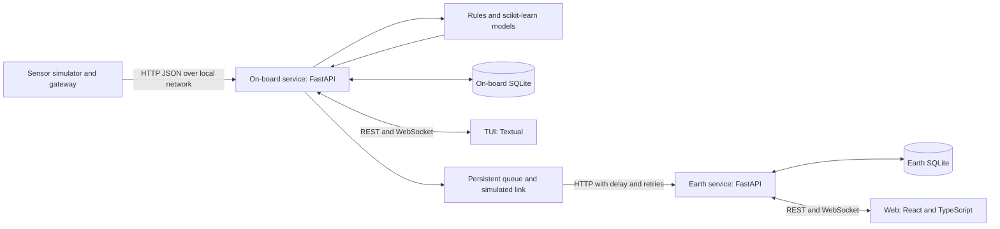

ASTRO-VITALS — proposed technical architecture
============================================

MVP design, reviewed on November 4, 2026. The [functional scope](MVP_ASTRO_VITALS.md) defines the planned experience. The [data and outputs contract](CONTRATO_DE_DATOS.md) is the shared reference for the variables, targets and availability of each component.

**Implementation update, October 28:** a [reduced prototype 0.1](prototype/README.md) already exists with an HTTP gateway, API and TUI. It uses Python 3.14 available on this machine, demonstration rules and memory; the rest of this document keeps the design planned for the full MVP. The screenshot provided by the team announces the resources for **November 13, 2026**. The demo incorporates a BIDMC record from PhysioNet and does not depend on that publication; see [alternative sources](DATOS_ALTERNATIVOS.md).

**General decision.** One monorepo, two logical nodes —on board and Earth— and four Python processes during the demonstration: simulator, on-board service, TUI and Earth service. The web app is built and served by the Earth node. Training is a separate task, run before starting the demonstration; inference happens on board.

The first forecast will be evaluated with HR and RR from BIDMC. The four-pattern classifier requires labeled synthetic sessions with synchronized activity, personal reference and CO₂. The solar simulation uses rules and dosimetry. It remains to be reviewed which challenge resources and which NASA references can be incorporated.



**Technologies chosen for the first implementation.**

| Part | Choice | Responsibility |
| --- | --- | --- |
| Python runtime | 3.14 in prototype 0.1. 3.12.x proposed for the full MVP | Verify compatibility with the training dependencies before fixing the common environment |
| Python dependencies | uv, pyproject.toml and uv.lock | Pin reproducible versions once the installation is verified |
| API | FastAPI, Pydantic 2, Uvicorn | Contracts, validation, REST, WebSocket and OpenAPI documentation |
| Python HTTP client | HTTPX | Send telemetry, query APIs and transmit to Earth |
| Python WebSocket client | websockets | TUI updates |
| Data and training | NumPy, pandas and scikit-learn | Generation, transformation, temporal features, training and evaluation |
| Classification | RandomForestClassifier | Recognize four patterns defined in the simulation |
| Forecast | RandomForestRegressor | Estimate heart rate at 60 seconds |
| Model artifacts | joblib and JSON manifest | Load own models and verify their feature contract |
| Astronaut interface | Textual and its components | State, hypothesis, evidence, procedures and history |
| Storage | SQLite with Python's sqlite3 | Measurements, analyses, episodes, interface events and queue |
| Earth web app | React + TypeScript + Vite | Received state, history and charts |
| Web styles and charts | Custom CSS and Recharts | Small, responsive interface and temporal visualization |
| Web development runtime | Node.js 24 LTS and npm | Build and develop; Node does not need to stay running to serve the built demo |
| Tests | pytest, HTTPX and Textual interaction tests | Contracts, model, continuity and user flow |
| Quality and scripts | Ruff, strict-mode TypeScript, PowerShell | Static checks and reproducible startup on Windows |

Patch versions will be pinned after the first installation and compatibility test; they are not invented in this document. uv can sync an environment from its lock file; Vite produces the web build. [uv documentation](https://docs.astral.sh/uv/concepts/projects/sync/), [Vite guide](https://vite.dev/guide/).

The first version needs neither a message broker nor a separate service for the model. The queue is a table in the on-board node and the analysis is a Python module. This scope prevents integration from depending on numerous services.

**Sensor connection and deployment.** The planned physical design is: wearable sensors → compatible gateway → spacecraft local network → on-board API. BLE, a wired connection or a cabin adapter will depend on the real device. HTTP starts at the gateway; it does not force each sensor to implement an API.

For the hackathon, the simulator takes the gateway's place and emits the same contract a device would use. It can run on another computer. The astronaut's laptop runs the TUI and connects to the on-board service; the sensors do not need to connect physically to it.

Everything can be demonstrated on one computer using separate processes and ports. With two machines, the Earth node or the simulator is distributed over the local network. Each node keeps its own database; the Earth view never reads the on-board database directly. Addresses and ports are configured through ONBOARD_URL, GROUND_URL and data paths.

Example of proposed ports: on-board node 8000 and Earth node 8001. In development, Vite uses its own server; in the demonstration, the Earth node serves the built static files. All resources needed to work without internet must be downloaded locally.

**Sample and working frequency.** Work is done with summarized parameters at approximately 1 Hz, one fictional astronaut and one cabin module. This frequency does not represent the acquisition of raw ECG or other signals. The simulator allows adjusting activity, noise, physiological evolution and signal loss.

The [input dictionary](CONTRATO_DE_DATOS.md#inputs) distinguishes the signals each model requires from the fields intended for display or review. The node derives time in activity, differences with respect to calibration and accumulated dose from observations with known time.

If a source delivers CO₂ in ppm, conversion to partial pressure needs the corresponding total pressure: ppCO₂ = ppm × total_pressure_mmHg / 1,000,000. Do not silently assume Earth pressure. A missing reading is represented as null with the corresponding quality, never as zero.

HRV will not be computed from a 1 Hz pulse column. Incorporating it would require inter-beat intervals and additional processing, so it is left out of the v1 model's inputs.

**Planned input contract.** In 0.1, POST /api/v1/telemetry accepts a flat sample with `hr`, `rr`, `co2`, `dose_rate`, `activity` and a per-sample source. In the MVP, the gateway will send a packet of one or several measurements with per-signal provenance. The migration must distinguish the format by version and preserve the replay of record 01. The new envelope contains schema_version, packet_id, run_id, gateway_id and sent_at. Each measurement contains:

| Field | Meaning |
| --- | --- |
| sample_id and device_id | Identity of the measurement and its device |
| crew_id and location_id | To whom or to which location it corresponds; a cabin reading may have no crew_id |
| measured_at | Moment of the measurement on the session timeline |
| signal, value, unit | Variable, numeric value or null, normalized unit |
| quality | valid, missing or invalid; stale is also computed from age |
| source_kind | simulated, replayed or measured |
| source_ref | Reference to the file, device or transformation that produced the data |

The server adds received_at. In a replay, original_measured_at is kept if an original date exists, or original_time_s if only a relative time exists, as in BIDMC. DONKI events use their own external event contract and keep their historical date.

Activity has a separate context contract. POST /api/v1/crew/{id}/activity receives event_id, run_id, activity (rest, exercise, recovery or unknown), activity_started_at if known, reported_at and source_kind (declared, replayed or simulated). The information known at the analysis instant is used. Without a known phase or start, the classifier indicates not_evaluable. The basic forecast can be computed with HR and RR. event_id allows retries without duplicates. Self-report is kept as an observation of the episode for human review.

Scenario identifiers, training labels, seeds and internal generator parameters stay in the evaluation files. They are not model inputs nor orders to generate an alert. run_id and identities are used for traceability and partitioning, not as predictor variables.

The API validates structure and units. It confirms acceptance after saving. Resending the same sample_id and content does not create another measurement; reusing it with different content is treated as a conflict. The simulator keeps an unconfirmed batch to retry it.

**Internal flow of the on-board node.**

1. Receive, validate and normalize the telemetry.
2. Persist the measurements and confirm reception to the gateway.
3. Update quality and gather the recent window of the astronaut and of the environment corresponding to their location.
4. Run rules and, when evaluable, extract features and run the models.
5. Save the analysis, update episode/state, insert ui_events and outbox, and advance the processing cursor in a single transaction. An incremental dose update includes in that same transaction its accumulated value and the integration cursor, to avoid double accumulation after a restart.
6. Expose the state to the TUI and allow the sender to attempt delivery to Earth.

A single Uvicorn worker is run per node. Inference and potentially blocking operations run outside the connection-handling loop, through a bounded executor; no inference task accumulates per packet. The interface can show new measurements while waiting for the next analysis, indicating up to which instant it was computed.

Storage uses a repository layer with short transactions and controlled connections, avoiding sharing an sqlite3 connection simultaneously between threads. Each node is the sole owner of its file. The processing cursor is persisted; on restart, the engine rebuilds the recent window from SQLite and avoids duplicating already saved analyses. The analysis key includes session, astronaut, window end and model version.

**Interpretation engine architecture.** It has four layers with distinct responsibilities:

| Layer | Implementation | Output |
| --- | --- | --- |
| Quality and availability | Python rules | Evaluable, calibrating, missing/stale signal, model unavailable |
| Pattern recognition | RandomForestClassifier | Class of the simulated pattern and internal decision information |
| Pulse forecast | RandomForestRegressor | Estimated HR in bpm for t + 60 s |
| Explained presentation | Templates and structured evidence | Indicative hypothesis, observations, alternatives and illustrative review |

Environmental rules keep working even if the model is unavailable. Limits taken from NASA references must include revision, section, unit, exposure duration and context. Parameters invented for scenarios carry the demonstration configuration label.

**Classifier v1.** Random Forest is chosen because it allows working with a table of temporal features and simple local training. The documentation describes its combination of trees; its performance in this project will be measured, not presumed superior to other options. [RandomForestClassifier](https://scikit-learn.org/stable/modules/generated/sklearn.ensemble.RandomForestClassifier.html).

Every 5 seconds the classifier summarizes the last 120 s of HR, RR and local CO₂ and adds phase, duration and personal differences. Its target is the pattern labeled in that window. Each model has its own feature manifest. [Inputs and targets per model](CONTRATO_DE_DATOS.md#what-each-model-learns)

The personal reference is obtained from 120 prior seconds of valid rest or from a saved calibration of the same fictional person. While it does not exist, pending calibration is shown. For the demo, an identified prior history can be loaded as such; never future data. The reference stays fixed during the episode being evaluated.

Four initial generator classes:

- baseline_expected: expected rest pattern in the simulation.
- activity_expected: expected response and recovery for an activity.
- persistent_recovery_deviation: recovery that departs from the simulated personal pattern.
- combined_cabin_physiology_pattern: joint cabin and physiology pattern defined by the generator.

The last class may be shown as "hypothesis of respiratory alteration related to the environment, within the simulated scenario". It is not equivalent to a confirmed diagnosis of hypercapnia. The classes do not include radiation or sensor failure: those cases belong to the environmental engine and the quality layer.

Initial engineering configuration: n_estimators=100, max_depth=8, min_samples_leaf=5, class_weight=balanced_subsample, random_state=42 and n_jobs=1. It is changed only if validation justifies it. Windows with transitions can be annotated as ambiguous and evaluated separately; do not assign the same label to an entire file containing different phases.

The initial quality criteria are applied to each required channel. The analysis indicates not_evaluable and the reason if history, calibration or a mandatory input is missing. Lack of calibration is presented as "calibrating". The coverage and age parameters are tuned during validation. [Availability rules](CONTRATO_DE_DATOS.md#what-the-system-computes-and-what-the-interface-shows)

An abstention threshold based on the classifier output is tuned with validation and recorded. A high score does not prove that a case is within the known domain, nor is it a medical probability. Cases outside the tested coverage require additional tests; the prototype does not promise to recognize all unknown scenarios.

**Forecast v1.** RandomForestRegressor uses only the HR and RR history up to t to estimate HR at t + 60 s. The label is obtained from the same record during training. With both signals valid, the forecast can be computed even when the activity is unknown or calibration and CO₂ are missing. [RandomForestRegressor](https://scikit-learn.org/stable/modules/generated/sklearn.ensemble.RandomForestRegressor.html).

It is compared with keeping the last HR and with extrapolating a short trend. The mean absolute error in bpm is measured on held-out records. With a source that identifies activity, the error can also be broken down at its transitions. If the model does not improve on the best reference in validation, that reference is used and the interface shows its name.

Six-hour physiological prediction is not a requirement of the v1 model. If a six-hour visualization is kept, it corresponds to an explicit projection of the scenario or of exposure under assumptions, and is distinguished from the trained pulse forecast. It is not obtained by repeatedly extending the 60-second model.

**Training and evaluation.** Fusion dataset v2 contains 120 sessions of 15 minutes, four for each of 30 fictional profiles. The generated HR, RR and CO₂ signals are synchronized within each session. Intensity, recovery times, noise and sensor gaps are varied. The position of the cabin change varies so that time in the rest phase alone does not identify that class.

20 profiles were assigned to training, five to validation and five to test with separate seeds. The four classes have examples in each partition. Transitions, simultaneous patterns and signal losses keep audit annotations to evaluate behavior in these scenarios.

For the forecast, BIDMC windows were prepared with an independent partition by participant. Activity, stress and sleep have their own land-based tables. RR-1 provides historical CO₂ and radiation from the facility in the original units. [Forecast preparation](data/bidmc/README.md) · [Classifier data](data/fusion_simulada/README.md) · [Inventory](DATOS_ALTERNATIVOS.md)

The same features.py module is used in training and inference. Each artifact stores the classifier or regressor plus a manifest.json with version, units, feature names and order, windows, horizon, seeds, partitions, dependency versions and metrics. Only own artifacts are loaded through joblib, since that format can execute code on load; the same version of the training environment is kept. [Model persistence in scikit-learn](https://scikit-learn.org/stable/model_persistence.html).

**Explanation and analysis contract.** The analysis identifies assessment_id, crew_id, run_id, window_start and window_end. Each component communicates availability, reason and input_quality. A trained result identifies model_version and features_version. The pattern value keeps the label or null, with the personal reference and hypothesis_text when applicable. forecast indicates a value in bpm or null, target instant and method (model, persistence or trend). The computed evidence (observations), the alternatives and the review steps (next_review_steps) accompany the episode. Self-report is stored separately with author and time. The TUI and Earth present the available results even if another component is calibrating or has insufficient data.

Observations are computed facts: differences with respect to the reference, duration of changes and available quality. They are not presented as causality percentages nor as exact attributions of the forest. The text is built with versioned templates to keep the output consistent and available offline. An LLM is not needed for this MVP.

The interface shows hypothesis and data source next to the simulation status. An illustrative procedure allows verifying signals and recording observations; it does not prescribe treatments. Human acknowledgment, the active condition and delivery to Earth are independent states. Acknowledging an alert does not resolve it.

**Solar storm and exposure.** The SEP event observed by STEREO A on May 11, 2024 at 04:07 UTC is already stored. The MVP can load that JSON offline. The simulated dosimeter generates its own readings. The RR-1 environmental series belongs to another mission and period and can be shown as an independent historical reference. [DONKI event](data/donki/README.md) · [RR-1 environment](data/iss_rr1/README.md)

Exposure is integrated from the equivalent dose rate, using valid intervals and consistent units: dose_μSv += mean_rate_μSv_h × seconds / 3600. If readings are missing, incomplete coverage is recorded; do not assume zero exposure. The accumulated value of a session does not decrease. The "simulate shelter" control modifies the rate according to an explicit scenario factor, without claiming that real shielding was computed.

An exposure projection can use D_future = D_current + assumed_rate × hours. The constant-rate hypothesis and the shelter alternative appear as assumptions; not as a medical prediction. The solar module reuses episodes, explanations and the queue, without a third trained model.

**Storage.**

| Table or group | Content |
| --- | --- |
| measurements | Normalized measurements and provenance, with unique sample_id |
| activity_events | Activity context with event_id, known phase and start |
| calibrations | Person, session and source rest segment, HR/RR values and version of the reference applied |
| external_events | Historical DONKI context and references |
| assessments | Versioned engine result and input window |
| episodes | Start, evolution, active condition and closure of episodes |
| observations and acknowledgements | Human actions associated with episodes |
| ui_events | Journal ordered by sequence to rebuild state changes |
| processing_state | Cursors and minimal data to recover processing |
| outbox | Pending messages, attempts, next delivery and confirmation |

Earth keeps received_messages with unique message_id and its own representation of received measurements, analyses and episodes. Reception, the update of that state and its ui_events are committed in a single transaction before responding to the sender. The MVP does not delete sessions automatically. Schemas are initialized with a registered database version.

**Minimum API and responsibilities.**

| Node | Proposed route | Responsibility |
| --- | --- | --- |
| On board | POST /api/v1/telemetry | Idempotent ingestion |
| On board | POST /api/v1/crew/{id}/activity | Record the known activity phase and its start |
| On board and Earth | GET /api/v1/crew/{id}/state | Available state and journal review |
| On board and Earth | GET /api/v1/events?after={seq} | Retrieve persisted changes after a sequence |
| On board and Earth | WS /api/v1/crew/{id}/stream?after={seq} | Deliver changes from a cursor |
| On board and Earth | GET /api/v1/episodes/{id} | Detail and available evidence |
| On board | POST /api/v1/episodes/{id}/observations | Record context provided by the astronaut |
| On board | POST /api/v1/episodes/{id}/acknowledgements | Record acknowledgment, without closing the condition |
| Earth | POST /api/v1/messages | Accept a link message after persisting it |
| On board and Earth | GET /health | Status of the service, model and storage |

The TUI uses only these contracts; it does not access SQLite nor import inference code. The Earth node exposes what was received and does not recompute as if it had instantaneous telemetry. Python contracts are defined with Pydantic and their OpenAPI schema serves as the reference for the TypeScript types. [FastAPI](https://fastapi.tiangolo.com/), [Pydantic](https://docs.pydantic.dev/latest/).

A state snapshot includes its sequence in a consistent read. Afterwards, the interface opens the WebSocket from that sequence and receives the missing persisted events before continuing. For the MVP's volume, the server can follow the SQLite journal by cursor, avoiding the race between snapshot and subscription. If retention/cursor does not allow recovery, it requests a new snapshot. An outage marks the view as outdated until data is recovered.

WebSocket improves visual updating; the persistent journal provides recovery. FastAPI documents support for WebSocket connections. [Official documentation](https://fastapi.tiangolo.com/advanced/websockets/).

**Spacecraft–Earth link.** Complete episodes and summarized telemetry batches are sent every five seconds. Messages have message_id, run_id, crew_id, source_sequence, observed_at, created_at, schema_version and payload. Earth adds received_at. Each version of an episode is identified so that a delayed message does not replace a more recent state.

The episode modification and the insertion into outbox are done in the same transaction. A background sender waits for delivery_due_at and performs the POST. Earth confirms after saving. Only then is it marked delivered; on failure it retries with bounded increasing wait. A repeated message is acknowledged without duplicating its content. The pending record survives restart.

The initial demonstration runs at 1x speed, with a configurable delay, for example 15 seconds, identified as simulated delay. That value is not presented as a physical Mars delay. An accelerated mode is an extension that would require a common simulation clock, visible labels and consistent metrics; virtual time is not silently mixed with real time.

**Astronaut interface.** Textual provides screens, events and components for a keyboard-navigated TUI. [Textual](https://textual.textualize.io/). Screens are limited to State, Assessment/Evidence and History. A persistent header indicates link, quality and age; the footer shows visible actions. Small trends are used for the signals, not diagnostic ECG charts.

The TUI keeps the alert state while another screen is consulted. Labels distinguish simulated data, measurements and projections. It does not depend on color alone. Requests and the stream run in background tasks; losing connection does not leave the screen showing values as if they were still updating.

**Earth interface.** React and TypeScript keep the last received state, history and connections through hooks and a small reducer. Native HTTP fetch and WebSocket are enough. Recharts draws the series with axes, units, gaps and differentiated segments for forecasts. [Recharts](https://recharts.org/).

An overview and the detail of one astronaut are enough. Measurement time, reception time and age are shown. The Earth service serves the Vite build at the same address as the API during the demo. Fonts and resources are included locally to avoid CDN dependencies.

**Proposed repository structure.**

```text
backend/
  pyproject.toml
  uv.lock
  src/astro_vitals/
    contracts/       # Pydantic and common events
    onboard/         # API, processing cycle and state
    ground/          # Earth receiver and API
    storage/         # SQLite repositories and schema
    analysis/        # quality, features, rules, models and explanation
    transport/       # outbox, retries and simulated link
    simulator/       # generation, replay and gateway client
    tui/             # Textual application
  tests/
frontend/ground/
  package.json
  package-lock.json
  src/
ml/                 # generation, training and evaluation scripts
models/             # own artifacts and manifests
scenarios/          # scenario configuration and references
data/               # development data; local databases outside Git
docs/               # contracts, sources, results and demo
scripts/            # startup and preparation via PowerShell
```

Local databases and personal information are not uploaded. Large files and their licenses are managed according to the source; a reproducible procedure to obtain them is kept. Fictional profiles are used during the demo.

**Acceptance tests.**

1. A sample sent by the simulator appears in the on-board state and then on Earth with the configured delay and its provenance.
2. A duplicate request does not duplicate measurements or episodes; the same ID with different content is rejected as a conflict.
3. Closing the TUI does not stop ingestion, inference or the queue. Interrupting Earth does not stop the on-board node.
4. Restarting the on-board node recovers pending messages and the analysis window; reconnecting delivers without duplicates.
5. A sensor gap produces a quality state and is never converted to zero. The interface detects outdated analysis or data.
6. Classification is evaluated by held-out profiles/sessions: confusion matrix, macro-F1, false alerts per simulation hour, delay and abstention rate.
7. The forecast is compared by MAE in bpm against the references. Training time, size and p50/p95 latencies on the demo machine are recorded.
8. Dosimetry respects units, coverage and accumulation; switching to shelter does not reduce dose already accumulated.
9. A teammate can interpret an alert, consult evidence and record an observation without instructions from the developer.
10. BIDMC replay with valid HR and RR history allows evaluating the basic forecast. In that same window, the pattern indicates insufficient context and environmental readings are absent. The forecast method remains visible in both views.

Contracts, transformations, data splitting, accumulation and link recovery are automated with pytest. Interaction tests cover the TUI's main tasks. The web app and the complete walkthrough are also reviewed on the presentation machine. No clinical accuracy is promised from these tests.

**Build order.** First contracts and a complete walkthrough without a model: simulator → API → SQLite → TUI → queue → Earth → web. Then quality, episodes and history. In parallel, data/model work with the same feature contract. Then classification, forecast and explanations are integrated; the solar episode is added through the existing engine. Finally, outages, reconnection, failures and the presentation are rehearsed.

Team roles are distributed among data/model, node and integration, TUI, and web/demo; they can be combined depending on how many people there are. The first integration point is the telemetry and analysis contract, not a finished screen.

**Pending decisions.** The [data contract](CONTRATO_DE_DATOS.md#pending-decisions) orders the decisions on sources, labels, calibration, evaluation and messages before each stage. For integration, it also remains to assign owners and hours, fix the Python environment after testing the dependencies and agree on the transition from the flat sample of 0.1 to the versioned packet. Physical integration remains as a future adapter.
